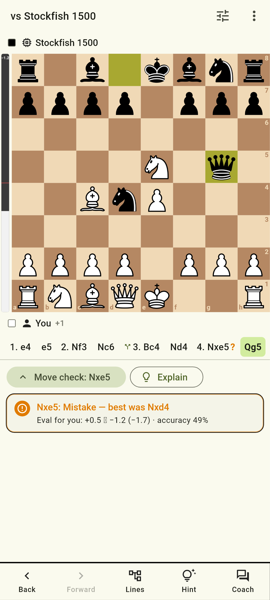
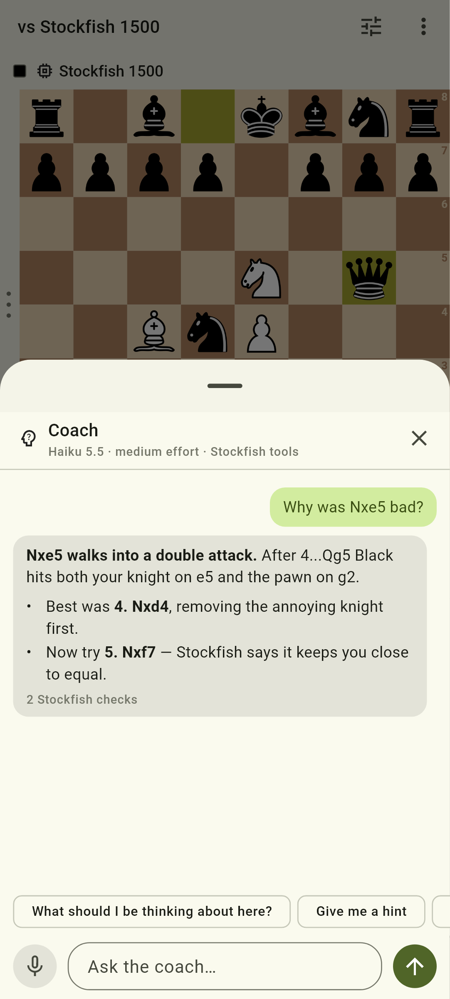
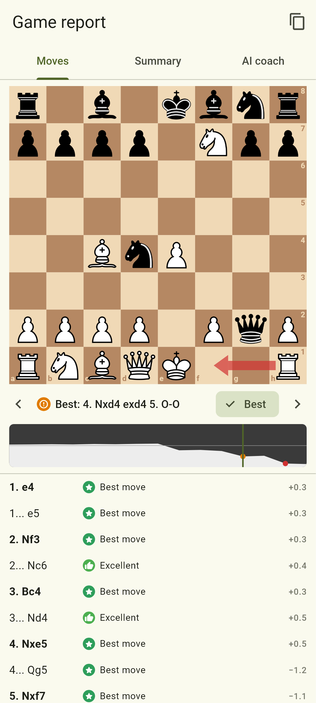
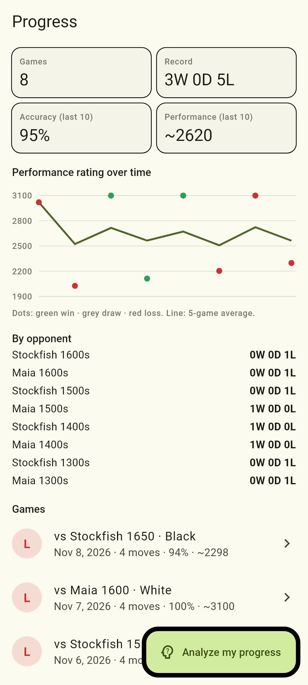

<div align="center">

# ♞ Chesster

**A private chess dojo for your phone and PC.**
Play human-like Maia or Stockfish, take back anything, and have an AI coach explain your moves in plain English, with Stockfish checking every claim.

[Download](#install) · [Features](#features) · [How it works](#how-it-works) · [Build it yourself](docs/BUILDING.md) · [Website](https://omgboom.github.io/chesster/)

   

</div>

---

## Why

Most chess apps make you choose. Engines are strong but play like robots, human-like bots don't explain anything, and post-game reports give you numbers without reasons. Chesster puts all of it into one quiet place to train:

- **Opponents that feel human.** [Maia-3](https://github.com/CSSLab/maia3) was trained on millions of real games and plays like a person at the rating you choose. [Stockfish](https://stockfishchess.org/) is there when you want a strict engine.
- **Training, not rated play.** Undo whenever you like and try another idea. Every attempt is kept as a branch, so you can compare them afterwards.
- **Explanations, not just numbers.** A Claude-powered coach explains *why* a move was good or bad in everyday language. It runs Stockfish while it talks, so it checks lines instead of guessing.
- **Private and yours.** It runs on your device. Your games stay in local files. The only thing that leaves the device is what you send to the AI coach, through your own API key.

Chesster is a fork of [Mobile Maia](https://github.com/Dash1971/maia-chess-android) by Dash1971. The whole original app is still included, as **Classic Maia**.

## Features

### 🥋 The Dojo
| | |
|---|---|
| **Opponents** | Maia at 600–2600, or Stockfish at 1320–3190 (`UCI_Elo`) or full strength. You can play White, Black or a random side. |
| **Undo & branching** | **Undo** returns you to your previous decision. You can also go back to any earlier move and play something else. Every line is kept: the **Lines** view shows the whole tree, and the PGN export includes every variation. |
| **Guidance switch** | One setting turns all in-game help on or off. When it's off, you play without help, and the post-game analysis is still available. |
| **Move check** | A small button rates your last move: *"Good move, but Nxc6 is better"*, *"Best move! Bg5 was also good"* or *"Blunder: best was Bg7"*. It also shows the evaluation before and after and the move's accuracy. |
| **Momentum bar** | A handle beside the board. Tap it to show the evaluation bar, and tap again to hide it. |
| **Explain** | Ask the AI why your move was good or bad, and what the better move does. |
| **Coach chat** | Talk to the coach during the game, by typing or **using the microphone**. It sees the current position and can run Stockfish itself. |

### 📊 After the game
- **Stockfish report.** Accuracy, average centipawn loss, blunders, mistakes and inaccuracies for both sides, an evaluation graph, and a board showing your move against the best move.
- **Performance Elo.** *"You played at roughly 1650 strength, close to your opponent (Maia 1600)."*
- **AI review.** The coach goes through your turning points, the habits behind them, and what to practise. You can ask follow-up questions.

### 📈 Progress
- Performance rating over time, your accuracy across the last 10 games, and your record against each opponent.
- **Progress coach.** The AI looks at all your games, can open any single game, and gives you a training plan. The conversation is saved.

### 💾 Everything is logged
Each game is saved as one JSON file containing the move tree, every verdict, the chats with the coach, the Stockfish report, the AI review and the PGN. The path is shown under *Dojo settings → Game logs folder*.

### 🔄 Sync between phone and PC
Optional: games, the progress-coach chat and Dojo preferences sync through a private GitHub repository you own, using a token limited to that repository. Your API key never syncs. See **[docs/SYNC.md](docs/SYNC.md)**.

### ♟ Classic Maia
The original Mobile Maia is still here: clocks, premoves, an analysis board, PGN import and export, Maia and Stockfish game review, and electronic boards (Android).

## Install

### Android (tested target: Pixel 8a)
1. Download the `…-arm64.apk` file from the [latest release](https://github.com/omgboom/chesster/releases/latest).
2. Open it on your phone and allow *Install unknown apps* for your browser or file manager when Android asks.
3. Updates install over the previous version, and your games are kept.

Chesster uses the package id `com.chesster.dojo`, so it installs next to the original Mobile Maia.

### Windows 10/11 (x64)
1. Download the `…-windows-x64.zip` file from the [latest release](https://github.com/omgboom/chesster/releases/latest).
2. Unzip it anywhere and run `chesster.exe`. Stockfish and ONNX Runtime are included, and nothing needs installing.
3. If SmartScreen warns about an unknown publisher, choose *More info → Run anyway*. The build is not code-signed.

### Turn on the AI coach (optional)
1. Create an API key at [console.anthropic.com](https://console.anthropic.com/).
2. In Chesster, open **Settings (⚙) → Anthropic API key**, paste the key and tap **Test connection**.
3. Choose the **model** and **thinking effort**. The default is *Claude Haiku 5.5, medium*, which costs a fraction of a cent per explanation. Sonnet, Opus and Fable give deeper answers at higher cost.

Everything except the AI coach works offline.

## How it works

```
┌────────────── Flutter app (Android / Windows) ──────────────┐
│  Dojo UI ── move tree ── JSON game logs                     │
│     │                                                        │
│     ├── Maia-3 (ONNX)   Android: ONNX Runtime (Kotlin)       │
│     │                   Windows: ONNX Runtime C API via FFI  │
│     ├── Stockfish       Android: multistockfish (native)     │
│     │                   Windows: stockfish.exe process (UCI) │
│     └── Claude coach ── HTTPS ──► api.anthropic.com          │
│            ▲ tool calls: analyze_position, evaluate_move,    │
│            └──────────── play_moves, legal_moves (Stockfish) │
└──────────────────────────────────────────────────────────────┘
```

- **Move quality** works like Lichess. Each move is labelled by how much it lowers your winning chances under Stockfish's evaluation: inaccuracy ≥ 5%, mistake ≥ 10%, blunder ≥ 15%. Accuracy uses the Lichess formula.
- **Performance Elo** is a rough estimate based on your average centipawn loss. Treat it as a trend line, not a rating.
- **The coach** calls the Messages API directly, streams its answer and uses adaptive thinking. It answers in plain English, and all chess analysis comes from local Stockfish through tool calls. The prompts are in [`lib/src/dojo/dojo_ai.dart`](lib/src/dojo/dojo_ai.dart).

Code map: [`lib/src/dojo/`](lib/src/dojo) (Dojo), [`lib/src/desktop/`](lib/src/desktop) (Windows support), [`docs/DOJO_PLAN.md`](docs/DOJO_PLAN.md) (design notes).

## Privacy

- No accounts, no analytics and no ads. The app does not phone home.
- Your games, settings and chats stay on your device. On Android that's the app's private storage; on Windows it's `%APPDATA%`.
- If you turn on [sync](docs/SYNC.md), they are also copied to your own private GitHub repository, and nowhere else.
- Your API key is kept in the platform's secure storage (Android Keystore on the phone, encrypted user storage on Windows) and is sent only to `api.anthropic.com`.
- The coach only sees what you ask it plus the current position or game report. Anthropic's [privacy policy](https://www.anthropic.com/legal/privacy) applies to those requests.

## Building from source

See **[docs/BUILDING.md](docs/BUILDING.md)**. In short:

```bash
git lfs install && git clone https://github.com/omgboom/chesster.git && cd chesster
flutter pub get && flutter test
flutter build apk --release --target-platform android-arm64   # Android
flutter build windows --release                               # Windows (after tool/fetch_windows_deps.ps1)
```

CI ([`.github/workflows`](.github/workflows)) runs the tests on every push and builds the signed APK and the Windows zip. Pushing a `v*` tag publishes a release.

## Contributing

Issues and pull requests are welcome. Please:
- run `flutter analyze` and `flutter test` (the Dojo tests are under `test/dojo/`);
- keep changes to upstream code small, so this fork can keep merging Mobile Maia updates (`git remote add upstream https://github.com/Dash1971/maia-chess-android.git`);
- include a screenshot for UI changes. `CHESSTER_SCREENSHOTS=1 flutter test test/dojo --update-goldens` regenerates the ones in `docs/screenshots/dojo/`.

## Credits & license

Chesster is free software under the **[GNU AGPL-3.0](LICENSE)**, the same license as the project it's forked from.

- [Mobile Maia](https://github.com/Dash1971/maia-chess-android) by Dash1971: the foundation of this app. Its original README is [here](docs/UPSTREAM_README.md).
- [Maia-3](https://github.com/CSSLab/maia3) by the University of Toronto CSSLab: the human-like model. See [MODEL_PROVENANCE.md](MODEL_PROVENANCE.md).
- [Stockfish](https://github.com/official-stockfish/Stockfish) (GPL-3.0), [multistockfish](https://github.com/lichess-org/dart-multistockfish) and [chessground](https://github.com/lichess-org/flutter-chessground) from Lichess.
- [ONNX Runtime](https://github.com/microsoft/onnxruntime) (MIT) and [onnxruntime_dart](https://pub.dev/packages/onnxruntime) (MIT).
- Claude by [Anthropic](https://www.anthropic.com/) powers the optional coach.

The full list is in [THIRD_PARTY_NOTICES.md](THIRD_PARTY_NOTICES.md).
